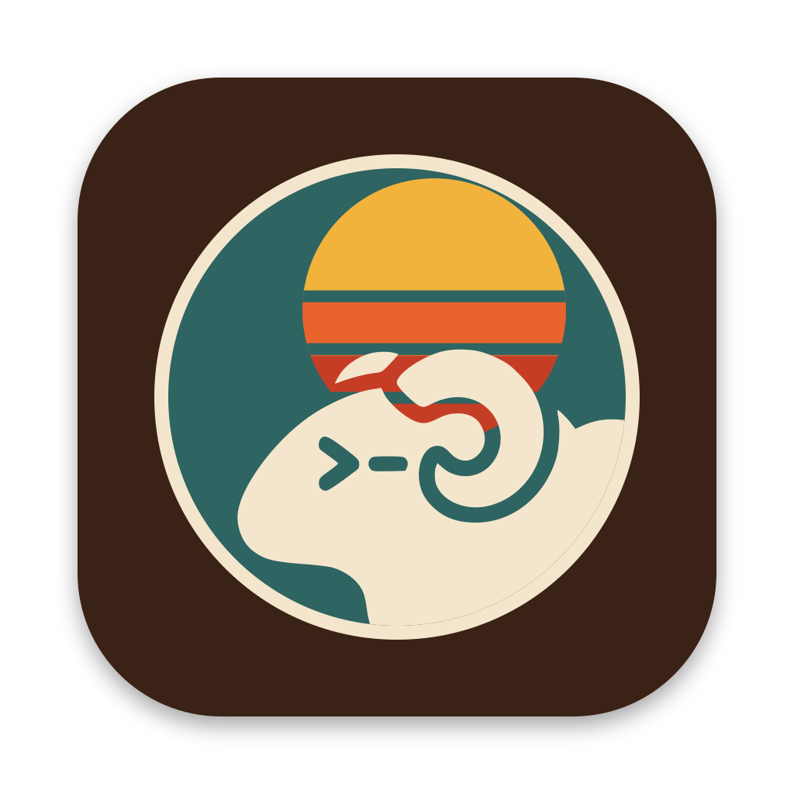
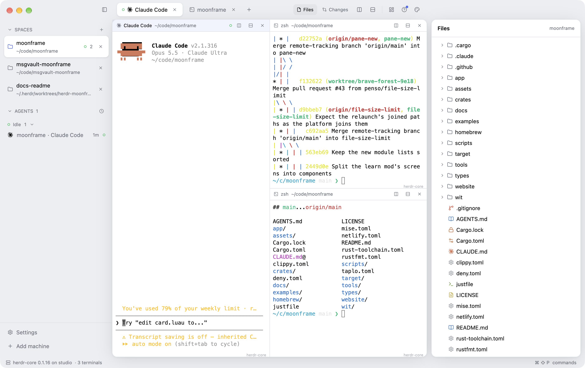
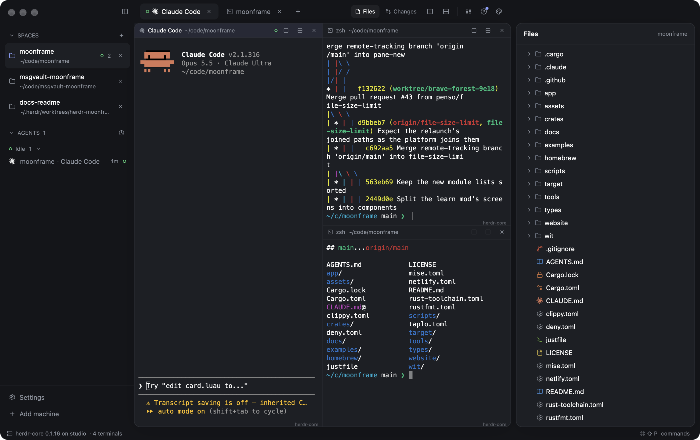
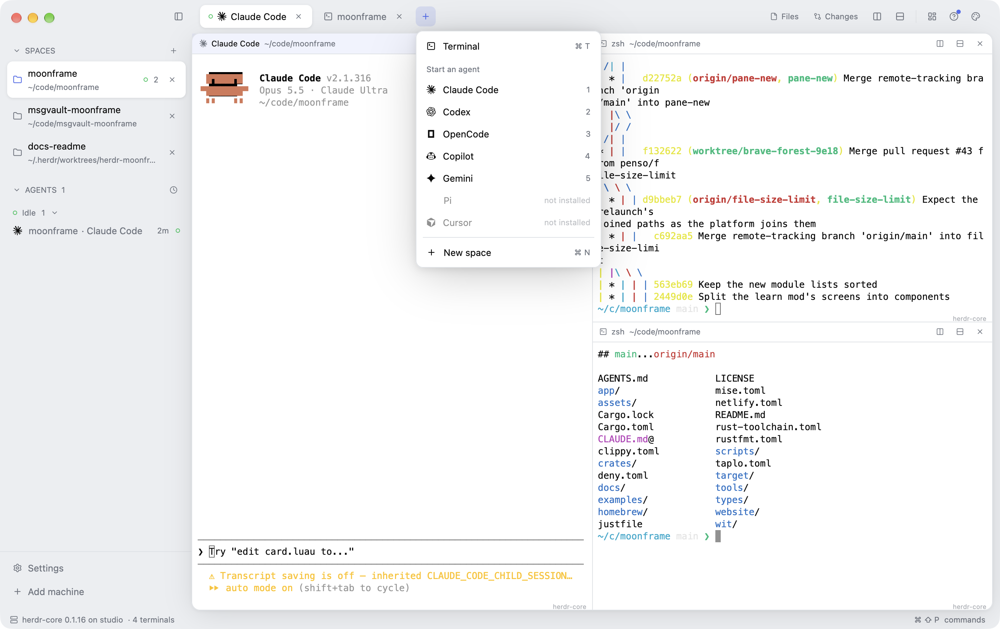
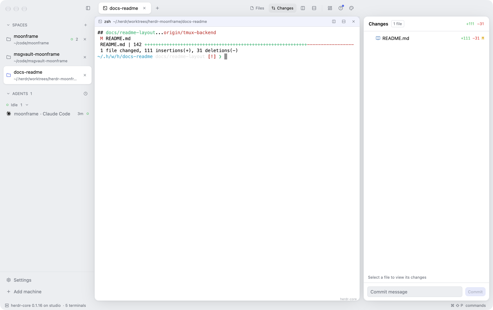
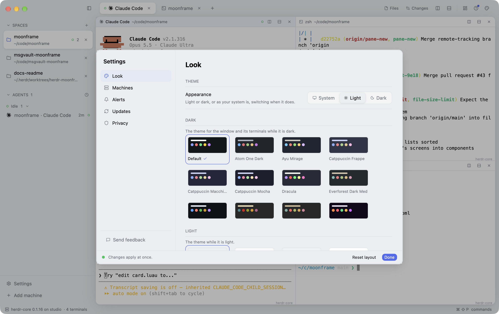

<p align="center">
  
</p>

<h1 align="center">Moonmux</h1>

<p align="center">
  A workspace for terminals and coding agents.<br>
  Every shell and agent keeps running when the window closes.
</p>

<p align="center">
  <a href="https://github.com/moonframehq/moonmux/releases"><b>Download</b></a> ·
  <a href="#install"><b>Install</b></a> ·
  <a href="#gallery">Gallery</a> ·
  <a href="#spaces-tabs-and-panes">Workspace</a> ·
  <a href="#terminals-that-outlive-the-window">Terminals</a> ·
  <a href="#coding-agents">Agents</a> ·
  <a href="#files-and-changes">Files and Changes</a> ·
  <a href="#settings-and-looks">Settings</a> ·
  <a href="#keys">Keys</a> ·
  <a href="#make-it-yours">Make it yours</a> ·
  <a href="#what-runs-with-what-access">Access</a> ·
  <a href="#how-it-is-built">How it is built</a>
</p>

Moonmux is a desktop app for people who run several coding agents at once.
Each repository gets a **space**, each task a **tab**, and each tab splits into
as many panes as the work needs: Claude Code in one, a test watcher in
another, a shell for git in a third. The sidebar shows every agent and what it
needs from you, a sound and a notification tell you when one finishes or asks
something while you look elsewhere, and a click takes you there.

None of those terminals live in the window. They run in
[herdr-core](https://github.com/herdrdev/herdr-core) or in
[tmux](https://github.com/tmux/tmux), whichever this machine has, so quitting,
updating or crashing Moonmux leaves every shell and agent running, and the
next launch puts them back where they were. Moonmux also sees the agents you
started outside it, in another app, in a plain `tmux` session or as another
agent's helpers, and lets you read and answer them without leaving your tab.

It is a native app written in Rust on [Moonframe](https://github.com/penso/moonframe),
drawn on the GPU with no browser inside, and it still changes while it runs:
edit a file, or ask an agent from the app's own **Make it yours** button, and
the window reshapes itself with your work still in place.

macOS (Apple Silicon and Intel), Linux (x86_64, ARM64) and Windows (x86_64).

## Gallery

<p align="center">
  
  <br>
  <sub><b>The window.</b> Spaces on the left, with the agents in them below, grouped by what they need from you. Each pane's header names its program and folder; the <b>+</b> menu starts agents, and <b>Files</b> and <b>Changes</b> open the focused pane's folder on the right.</sub>
</p>

<table>
  <tr>
    <td width="50%" valign="top">
      
      <br>
      <sub><b>Light and dark.</b> System, Light or Dark, with a theme of your choice for each, in Settings &gt; Look; the terminals follow.</sub>
    </td>
    <td width="50%" valign="top">
      
      <br>
      <sub><b>Start an agent.</b> The <b>+</b> menu opens a terminal, or starts Claude Code, Codex, OpenCode, Copilot, Gemini, Pi or Cursor in a new tab, by number; those not installed are greyed out.</sub>
    </td>
  </tr>
  <tr>
    <td width="50%" valign="top">
      
      <br>
      <sub><b>Changes.</b> What changed in the focused pane's repository, with each file's diff a click away, and a commit box. <b>Files</b> browses the same folder with read-only previews.</sub>
    </td>
    <td width="50%" valign="top">
      
      <br>
      <sub><b>Settings.</b> Look, Terminals, Machines, Alerts and Updates. <b>⌘⇧P</b> finds any command.</sub>
    </td>
  </tr>
</table>

## Spaces, tabs and panes

- **A space per repository.** A space holds work in one folder. Unnamed, it
  takes the name of the folder its first terminal is in (on tmux, where that
  shell has `cd`'d to since); right-click to give it a name that stays. The sidebar shows each
  space's folder and the loudest state of the agents in it.
- **A tab per task.** Each space has tabs. A tab running an agent is named
  after it and drawn with its icon; a shell tab is named after its folder.
- **Panes.** Split a tab right or down as often as you like, from the title
  bar, a pane's header or the keys; panes nest. Each pane's header shows its
  program, its folder and the backend it runs on, and has its own split and
  close buttons. Closing a pane ends its shell; closing the window does not.
- **Everything comes back.** Spaces, tabs, splits and which tab you were on
  are kept across launches; each pane reattaches to the same running shell.

## Terminals that outlive the window

Every pane runs in one of two backends, chosen in **Settings > Terminals**:
**Auto** (herdr-core when it is installed, else tmux), **herdr-core** or
**tmux**. A pane stays on the backend it opened on for its whole life, through
relaunches; changing the choice applies to new panes.

| | herdr-core | tmux |
| --- | --- | --- |
| Where Moonmux's terminals live | herdr-core's server, labelled as Moonmux's | a tmux server of their own: `tmux -L moonmux ls` |
| Agent status | reported by the agents themselves (OSC 7501), exactly | read off each agent's screen (its "esc to interrupt", its "Do you want to…") |
| Other terminals it sees | every terminal herdr-core runs: other apps, `hc run`, agents' helpers | every pane of your own tmux servers (the default one and any `tmux -L name`) |
| Machines | the computers herdr-core reaches over SSH (Settings > Machines) | — |
| Install | [herdr-core](https://github.com/herdrdev/herdr-core) (`hc`) | `brew install tmux`, `apt install tmux` |

Either one keeps your shells and agents running after the app quits, and the
next launch finds them again. The status line names the backends in use and
their versions.

## Coding agents

- **Start one in a click.** The **+** menu starts Claude Code, Codex,
  OpenCode, Copilot, Gemini, Pi or Cursor in a new tab of the current space,
  typed into the new shell exactly once, even across reloads; press its
  number while the menu is open. Agents that are not on this machine are
  shown greyed out. Amp, Droid, Grok, Kiro and Qwen Code are recognised by
  name and icon when you start them yourself.
- **See who needs you.** The agents list groups agents under **Needs you**,
  **Working**, **Done** and **Idle**, most urgent first, each with how long it
  has been in that state; the clock button groups them by space instead. A
  done agent you have looked at turns idle. Helpers an agent started show
  under it.
- **Go there.** A click on one of your agents shows its pane; **⌘J** goes to
  the one that needs you.
- **Peek at the others.** Agents running outside your spaces (in another app,
  started with `hc run`, in your own tmux sessions) are listed apart; a click
  opens a sheet with their screen, where you can type an answer, press Enter
  or Esc, move with the arrows, or interrupt them.
- **Alerts.** When one of your agents needs you or finishes while you are not
  looking at it, Moonmux plays a sound and posts a notification; clicking it
  takes you to the agent. Settings > Alerts turns them off, or on for agents
  elsewhere too. They fire on a change only, never for what was already so
  when the app started.

## Files and Changes

Two panels open beside the tabs from the title bar, and follow the focused
pane's folder:

- **Files**: the folder as a tree, opened lazily, with git's changes marked
  and a bounded read-only preview of a file.
- **Changes**: the repository's uncommitted files with their added and removed
  lines, each file's diff, and a commit message box that stages everything
  and commits. It follows a branch switch and a repository created later.

## Settings and looks

**Settings** (⌘,) has six pages:

- **Look**: Appearance (System, Light or Dark, following the system live), a
  theme for light and one for dark picked from cards of their colours, the
  tab style (pills, underline or cards), pane headers (always, when split or
  never), and the status line.
- **Terminals**: where new panes run (above).
- **Machines**: the computers herdr-core reaches (`hc machine ls`), and how to
  add one (`hc machine add <host>`).
- **Alerts**: sounds and notifications, for your agents and optionally the
  others.
- **Updates**: Moonmux's and herdr-core's versions, Check Now, and the
  releases page. Moonmux asks GitHub for its newest release once a day and
  offers it; on macOS it installs it and relaunches (also Moonmux > Check
  for Updates…).

The **command palette** (⌘⇧P) finds any command the menus offer, with its
key. A short **Welcome** introduces the app on its first launch, and comes
back from Help.

## Keys

| Key | Does |
| --- | --- |
| ⌘N | New space |
| ⌘T / ⌘⇧W | New tab / close tab |
| ⌘D / ⌘⇧D | Split right / down |
| ⌘W | Close pane (ends its shell) |
| ⌘1…⌘8, ⌘9 | Tab N, last tab |
| ⌘⌥← / ⌘⌥→ | Previous / next tab |
| ⌘⌥↑ / ⌘⌥↓ | Previous / next space |
| ⌘B | Show or hide the sidebar |
| ⌘J | Go to the agent that needs you |
| ⌘⇧P | Command palette |
| ⌘, | Settings |
| ⌘M | Minimize |

Right-click a space or tab to rename it. On Linux and Windows, Ctrl takes ⌘'s
place.

## Make it yours

**Moonmux > Developer Mode** turns on the tools in View: Components,
Inspect Element (⌥⌘I), Developer Tools (⌥⌘J), and Reload Modules (⌘R).
It is on by default, including packaged builds, and remembers your choice.
Run `just run --dev` to enable it for one launch.

Most desktop apps are finished when you get them: you can change their
settings, and that's it. Moonmux is **malleable software**, an app you
reshape while it runs. Moonframe redraws the window the moment one of its
files changes, keeping your spaces, tabs and shells as they were: no
rebuild, no restart.

Everything on screen is a Luau file in `app/`: the shell in `app/main.luau`,
each part of the window a mod in `app/mods/` (the sidebar, the workspace, the
panels, Settings), shared pieces in `app/components/`, and the look in
`app/style.luau`. Copy one into `~/.config/moonmux` (same layout) and change
it there: the window reloads as you save, keeping its state, and updates
never touch your copy. A mistake never blanks the window; the broken part
keeps its last good version and says why.

You don't have to write it yourself. **Make it yours** (the sparkles at the top
right) hands what you ask to a coding agent, which changes the app in front
of you; Moonframe's skills in `.claude/skills` teach any agent how. Mods
others publish install from git with `moonmux mod install <owner/repo>`. See
[Moonframe](https://github.com/penso/moonframe) for the building blocks.

## What runs with what access

- **The window's Luau is sandboxed.** It has no file, network or process
  access, a memory cap and an instruction budget. What reaches the machine
  goes through a provider written in Rust in this repository.
- **Only the app's own mods act on terminals.** Typing into a terminal,
  pressing its keys, interrupting it, reading its screen or ending a shell
  reach any terminal herdr-core or your tmux servers run, so the `core`
  provider only takes them from the mods its `provider.toml` names
  (`writers`); a mod installed from elsewhere is refused unless you add it.
  The same goes for committing (the `changes` provider). That list limits
  who acts, not who sees: what the app shares, such as the agents list and
  an open peek's screen text, any mod can read, so only add mods you trust.
- **Agents are typed only from a fixed table.** The **+** menu can start only
  the agents the app knows, found on this machine, once per pane.
- **Repositories are not trusted.** Files and Changes run git with nothing a
  repository's own configuration could execute: no filter drivers, external
  diffs, text conversions or fsmonitor hooks, and every read is size-capped
  and kept inside the folder.
- **No telemetry.** Moonmux talks to herdr-core and tmux on this computer;
  herdr-core reaches your machines over ssh; Make it yours goes to the coding
  agent you pick, only when you send it. Once a day it asks GitHub's API
  for its newest release, and downloads one only when you choose to install
  it. The only page the app opens is the releases page, when you ask for it.

## How it is built

| Part | What it does |
| --- | --- |
| [Moonframe](https://github.com/penso/moonframe) | The library the window runs on: Luau laid out by Rust and GPUI, live reload, components, themes, terminals (alacritty_terminal), notifications |
| `app/` | The whole interface in Luau: the shell, mods, components, style |
| `src/core/` | The `core` provider (`app.core`): the terminals and agents of every backend, behind one `Backend` trait (`herdr.rs`, `tmux/`), and the actions mods ask for |
| `src/folder.rs`, `src/changes.rs`, `src/git.rs` | The Files and Changes providers, and the hardened git they share |
| `src/programs.rs` | The agents the app starts and recognises, and finding them on this machine |

Contributors and agents: read [AGENTS.md](AGENTS.md).

## Install

Download the latest [release](https://github.com/moonframehq/moonmux/releases):
the macOS disk image (universal, signed and notarized), or the Linux or
Windows archive. Moonmux needs [herdr-core](https://github.com/herdrdev/herdr-core)
(`hc`; see its README for how) or tmux.

Every release is signed with Sigstore and carries GitHub attestations of how
it was built; see [verifying a download](docs/releasing.md#verifying-a-download).
The Linux and Windows builds are new and less tried than the macOS one.

## Build from source

You need herdr-core or tmux, and Rust (see `rust-toolchain.toml`). Each
backend is a cargo feature, both on by default: build one alone with
`cargo build --no-default-features --features gpui,tmux` (or `herdr-core`).
What draws the window is a feature too: `gpui` by default, or `rune` for
Moonframe's experimental Rune renderer (no Settings or Make it yours
window yet).

```sh
just run      # the window; edits to app/ show live
just run-rune # the same app drawn by Rune instead of GPUI
just check    # load the app headlessly
just hooks    # once per clone: commit-message hook, Cargo.lock merges
just features # clippy and tests with each backend alone, and on Rune
just ci       # what CI runs (`just setup-ci` installs its tools)
just bundle   # target/bundle/Moonmux.app
```

Releases are cut with `just release`; see [docs/releasing.md](docs/releasing.md).

## License

MIT; see [LICENSE](LICENSE). Third-party icons in the app are credited in
[NOTICE](NOTICE).
